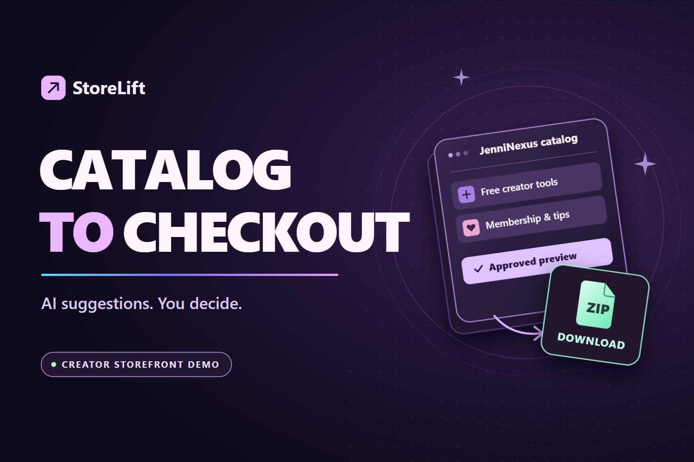

<div align="center">



# StoreLift

### Catalog in. Storefront out.

**AI drafts the listing. You approve it. PayPal Sandbox completes the sale.**

[](LICENSE)
[](docs/SETUP.md)
[](docs/CHECKOUT.md)
[](docs/CATALOG.md)
[](docs/DEVELOPMENT.md)

[Local setup](docs/SETUP.md) · [Judge walkthrough](docs/JUDGE-WALKTHROUGH.md) · [PayPal resources](docs/PAYPAL.md) · [Docs index](docs/README.md)

</div>

StoreLift turns a creator catalog into an editable storefront preview. Import your own CSV, or the public JenniNexus products page, review each listing, and approve one revision you can export or embed. A separate Creator Demo Kit carries a buyer from PayPal Sandbox approval to a verified receipt and a protected ZIP download.

- **Import what you already have.** A CSV of up to 20 listings, or one supported public catalog URL.
- **Keep the meaning of every link.** Free downloads stay free, tips stay tips, memberships stay memberships. AI suggests wording and categories, never prices.
- **Approve once, reuse everywhere.** The preview, the JSON export and the embeddable card all read the approved revision, not the model's draft.
- **Finish a real Sandbox sale.** JavaScript SDK approval, server-side Orders v2 capture, a receipt bound to the buyer's session, and a download link that a signed refund revokes.

## Quick start

```bash
php scripts/build-demo-kit.php
php -S 127.0.0.1:8015 -t public public/index.php
```

Open <http://127.0.0.1:8015/>. Catalog import, review and approval work immediately; the kit checkout needs PayPal Sandbox credentials. On Windows, `pwsh -NoProfile -File scripts/start-local.ps1` builds the kit and starts the server on a free port.

Full walkthrough — PHP 8.3 extensions, the Sandbox Merchant app, the configuration script, the OAuth check and hosting: **[docs/SETUP.md](docs/SETUP.md)**.

## The journey

| Step | What happens | Reference |
| --- | --- | --- |
| 1 · Import | A CSV upload, or one allowlisted URL, is fetched and parsed into listings with source evidence. | [CATALOG](docs/CATALOG.md) |
| 2 · Review | AI proposes descriptions, categories, action labels and missing-information warnings. Editing by hand always works. | [CATALOG](docs/CATALOG.md) |
| 3 · Approve | Approval freezes a catalog revision for this browser session. Export and embed read that revision. | [CATALOG](docs/CATALOG.md) |
| 4 · Checkout | The Creator Demo Kit order is created, approved in PayPal Sandbox, captured server-side and released as a signed ZIP link. | [CHECKOUT](docs/CHECKOUT.md) |

## Docs

| | |
| --- | --- |
| [`docs/README.md`](docs/README.md) | Documentation index |
| [`docs/SETUP.md`](docs/SETUP.md) | Install, configure Sandbox, run locally, mount under a path |
| [`docs/JUDGE-WALKTHROUGH.md`](docs/JUDGE-WALKTHROUGH.md) | The three-step review path for a fresh session |
| [`docs/CATALOG.md`](docs/CATALOG.md) | CSV format, supported imports, AI configuration, approval rules |
| [`docs/CHECKOUT.md`](docs/CHECKOUT.md) | Order, capture, webhook, entitlement and download verification |
| [`docs/PAYPAL.md`](docs/PAYPAL.md) | Official PayPal references and optional developer tooling |
| [`docs/DEVELOPMENT.md`](docs/DEVELOPMENT.md) | Tests, source layout, stylesheet tokens, demo kit |
| [`AGENTS.md`](AGENTS.md) | Repository map for contributors and coding agents |

## Scope

StoreLift is a **Sandbox-only preview tool**. It is not a payment processor, a hosted service or a storefront host: published files are previews for one browser session, and the shipped demo inventory is explicitly labelled test stock. Shopify, Etsy and Gumroad listings work through the CSV; a direct importer for them is not part of this version.

## Contributing

MIT — use, fork, customize. See [`LICENSE`](LICENSE). The PayPal SDK loads from PayPal at checkout; everything else is local PHP, vanilla JavaScript and one stylesheet.

<div align="center">

If StoreLift helps you get a catalog online:

[Star this repo](https://github.com/jenninexus/storelift) · [Links](https://jenninexus.com/links) · [Patreon](https://www.patreon.com/c/JenniNexus) · [PayPal](https://paypal.me/jenninexus)

Built by [Jenni](https://github.com/jenninexus) for the [PayPal AI Hackathon](https://paypalaihackathon.devpost.com/) · [jenninexus.com](https://jenninexus.com)

</div>
